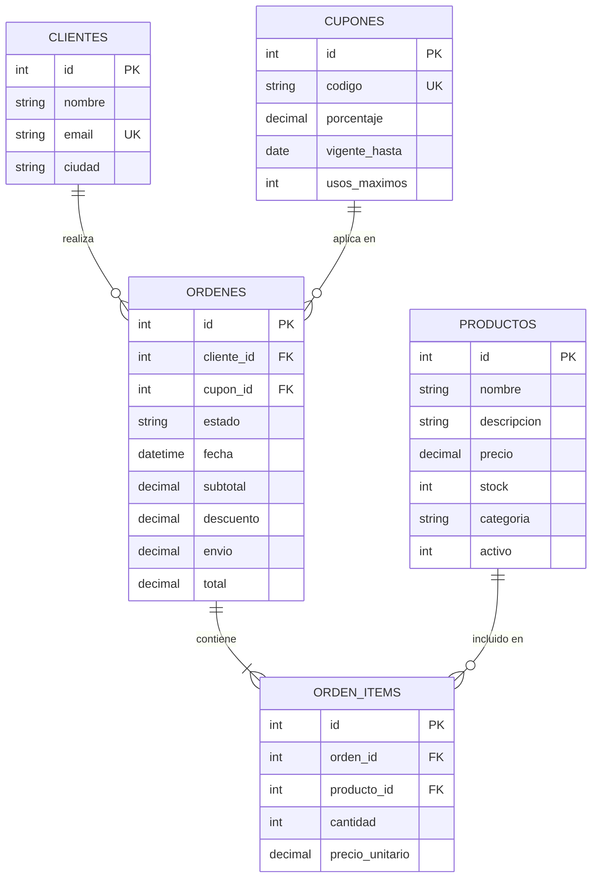

# Laboratorio #2 - Caso 5: Juguetería Online "Mundo Juguete"

> **Materia:** Programación Web & BackEnd  
> **Estudiante:** Daniel Ortiz Rivera  
> **Caso de Estudio:** Caso 5 - Juguetería Online "Mundo Juguete" con control de inventario infantil en transacciones ACID, validación estricta de cupones, cálculo dinámico de tarifas de envío, métricas de agregación SQL e integración con Agente de IA en n8n.

---

## 📋 Resumen del Proyecto

Este repositorio contiene la solución de extremo a extremo para el **Laboratorio 2 (Caso 5)** adaptada al dominio de la juguetería **"Mundo Juguete"**, estructurada en una arquitectura desacoplada y robusta:

1. **Base de Datos Relacional (`schema.sql`):** Esquema SQLite con llaves foráneas (`PRAGMA foreign_keys = ON`), restricciones de integridad `CHECK`, transacciones ACID e inserción de datos iniciales (*seed data* de juguetes, clientes y órdenes representativas).
2. **Backend API REST (`/backend`):** Servidor Node.js con Express organizado por capas (`routes/`, `controllers/`, `services/`, `db.js`), validaciones con códigos de estado HTTP apropiados (200, 201, 400, 404, 409) y soporte de transacciones atómicas con `better-sqlite3`.
3. **Frontend React SPA (`/frontend`):** Aplicación cliente construida con Vite, React 19, React Router (mínimo 4 vistas con navegación activa), servicio centralizado de peticiones (`services/api.js`), Custom Hook `useFetch` con manejo unificado de estados (`data`, `loading`, `error`, `refetch`), formularios controlados y filtros combinados con búsqueda y ordenamiento en tiempo real.
4. **Automatización & Agente IA (`n8n_workflow.json`):** Flujo de trabajo exportado para n8n sin credenciales externas con Webhook entrante, router condicional (*Switch*), generación de descripciones didácticas y comerciales de juguetes, motor de recomendaciones personalizadas para el carrito y contrato estandarizado `{ ok, data, error }`.
5. **Colección de Pruebas:** Archivo de Thunder Client (`thunder-collection_laboratorio2.json`) y suite automatizada de pruebas HTTP (`backend/tests/test_endpoints.js`).

---

## 🏛️ Arquitectura del Sistema

```
laboratorio2/
├── schema.sql                         # DDL y DML de base de datos relacional (SQLite)
├── n8n_workflow.json                  # Workflow exportado de n8n para el Agente IA
├── thunder-collection_laboratorio2.json # Pruebas funcionales de Thunder Client
├── BITACORA_IA.md                     # Registro de interacción y prompts con IA Copilot
├── README.md                          # Documentación completa del proyecto
│
├── backend/                           # Servidor Express por capas
│   ├── .env                           # Variables de entorno (PORT, DATABASE_FILE, N8N_URL)
│   ├── .env.example                   # Plantilla de variables de entorno
│   ├── package.json                   # Dependencias (express, better-sqlite3, cors, dotenv)
│   ├── data/
│   │   └── tienda.db                  # Base de datos SQLite generada
│   ├── tests/
│   │   └── test_endpoints.js          # Script de pruebas automatizadas de endpoints
│   └── src/
│       ├── index.js                   # Punto de entrada Express y registro de routers
│       ├── db.js                      # Conexión persistente better-sqlite3 con foreign keys
│       ├── initDb.js                  # Inicializador y ejecutor de schema.sql
│       ├── routes/                    # Enrutadores Express (Rutas HTTP)
│       │   ├── productos.routes.js
│       │   ├── cupones.routes.js
│       │   ├── clientes.routes.js
│       │   ├── ordenes.routes.js
│       │   ├── resumen.routes.js
│       │   └── ia.routes.js
│       ├── controllers/               # Controladores HTTP (Manejo de req, res y códigos HTTP)
│       │   ├── productos.controller.js
│       │   ├── cupones.controller.js
│       │   ├── clientes.controller.js
│       │   ├── ordenes.controller.js
│       │   ├── resumen.controller.js
│       │   └── ia.controller.js
│       └── services/                  # Capa de negocio y consultas SQL (Transacciones ACID)
│           ├── productos.service.js
│           ├── cupones.service.js
│           ├── clientes.service.js
│           ├── ordenes.service.js
│           ├── resumen.service.js
│           └── ia.service.js
│
└── frontend/                          # Cliente React 19 + Vite
    ├── package.json                   # Dependencias (react, react-dom, react-router-dom, lucide-react)
    ├── vite.config.js                 # Configuración de compilación Vite
    ├── index.html                     # HTML5 semántico
    └── src/
        ├── main.jsx                   # Montaje del Virtual DOM
        ├── App.jsx                    # Enrutador principal (React Router con 5 vistas)
        ├── index.css                  # Sistema de diseño, variables CSS y estilos globales
        ├── App.css                    # Clases utilitarias
        ├── services/
        │   └── api.js                 # Cliente API único con manejo unificado de errores
        ├── hooks/
        │   └── useFetch.js            # Custom Hook para peticiones { data, loading, error, refetch }
        ├── components/                # Componentes reutilizables
        │   ├── Navbar.jsx             # Barra de navegación con indicador de ruta activa
        │   ├── MetricCard.jsx         # Tarjetas de indicadores numéricos (KPIs)
        │   ├── StatusBadge.jsx        # Insignias visuales de estado de órdenes
        │   ├── AlertBox.jsx           # Banners de alerta para éxito, advertencia o error
        │   └── Modal.jsx              # Modal accesible con backdrop y tecla Escape
        └── pages/                     # Vistas principales del sistema
            ├── DashboardPage.jsx      # Vista 1: Panel de Analítica con agregaciones de /api/resumen
            ├── ProductosPage.jsx      # Vista 2: Catálogo con CRUD, filtros, orden y generación IA
            ├── NuevaOrdenPage.jsx     # Vista 3: Formulario reactivo de checkout y validación de cupones
            ├── OrdenesPage.jsx        # Vista 4: Gestión de pedidos, flujo de estados y cancelación
            └── AsistenteIAPage.jsx    # Vista 5: Laboratorio interactivo del Agente IA (n8n)
```

---

## 🗄️ Modelo de Base de Datos Relacional (`schema.sql`)

El esquema de base de datos implementa las cinco entidades de Mundo Juguete con integridad referencial estricta:



### Entidades y Restricciones de Integridad

1. **`productos`**: Catálogo de juguetes en categorías infantiles (`Construcción`, `Muñecas y figuras`, `Juegos de mesa`, `Peluches`, `Arte y manualidades`, `Vehículos y Exterior`) con precio positivo (`CHECK (precio > 0)`), control de existencias (`CHECK (stock >= 0)`), categoría y bandera `activo`.
2. **`clientes`**: Identificación de compradores, correo electrónico único (`email UNIQUE`) y ciudad en Costa Rica para el cálculo dinámico del costo de despacho.
3. **`cupones`**: Reglas de descuento porcentual (`CHECK (porcentaje > 0 AND porcentaje <= 100)`), fecha límite de vigencia (`vigente_hasta`) y cantidad máxima de canjes permitidos (`usos_maximos > 0`).
4. **`ordenes`**: Encabezado del pedido con cliente, cupón opcional, estado restringido a `CHECK (estado IN ('nueva', 'pagada', 'enviada', 'entregada', 'cancelada'))`, fecha ISO, subtotal, descuento, costo de envío y total.
5. **`orden_items`**: Detalle en cascada (`ON DELETE CASCADE`) con cantidad entera positiva (`CHECK (cantidad > 0)`) y precio unitario histórico capturado en el momento de la venta.

---

## ⚙️ Reglas de Negocio Implementadas

### 1. Transacciones Atómicas para Órdenes (`db.transaction`)
- Al crear una orden (`POST /api/ordenes`), se ejecuta una transacción ACID que:
  - Valida la disponibilidad de stock de cada producto solicitado. Si algún ítem no tiene inventario suficiente, revierte toda la operación y retorna un error con código **HTTP 409 (Conflict)**.
  - Descuenta inmediatamente el inventario en la tabla `productos`.
  - Calcula el subtotal histórico multiplicando cantidades por precios vigentes.
  - Inserta la cabecera en `ordenes` y todos los renglones en `orden_items`.
- Al cancelar una orden (`PATCH /api/ordenes/:id/cancelar`), dentro de una transacción atómica se revierte el estado a `'cancelada'` y se **repone el stock** a cada producto involucrado. Solo se permite cancelar pedidos en estado `'nueva'` o `'pagada'`; si ya fue `'enviada'` o `'entregada'`, se rechaza con **HTTP 409**.

### 2. Validación de Cupones con HTTP 409
Un cupón se evalúa bajo 4 restricciones:
- Existencia en el catálogo.
- Fecha actual no superior a `vigente_hasta`.
- Cantidad de usos globales registrados en órdenes activas no superior a `usos_maximos`.
- El cliente no debe haber canjeado previamente dicho cupón en órdenes vigentes.
- Si no cumple cualquiera de estas condiciones, se rechaza con **HTTP 409 (Conflict)** y mensaje explicativo.

### 3. Matriz Tarifaria de Envíos
- El costo de envío se determina según la ciudad de destino del cliente registrado:
  - San José: `$3.50`
  - Heredia: `$4.00`
  - Alajuela: `$4.50`
  - Cartago: `$5.00`
  - Puntarenas / otras provincias: `$7.00`
- **Regla de Envío Gratuito:** Si el monto neto `(subtotal - descuento) >= $50.00`, el costo de envío es automáticamente `$0.00`.

### 4. Agregaciones SQL en `/api/resumen`
El endpoint calcula en la base de datos sin procesar loops en memoria:
- `SUM(oi.cantidad * oi.precio_unitario)` agrupado por categoría (`GROUP BY p.categoria`).
- Top 3 productos más vendidos calculados por unidades vendidas (`SUM(oi.cantidad) DESC LIMIT 3`).
- Total de órdenes activas (`COUNT(*)`), total recaudado (`COALESCE(SUM(total), 0)`), valor promedio por orden (`COALESCE(AVG(total), 0)`), recaudo de envíos y descuentos otorgados.
- Alertas de reposición de stock crítico para productos con existencias &le; 5 unidades.

---

## 🤖 Integración con n8n (Agente IA)

El archivo [`n8n_workflow.json`](./n8n_workflow.json) contiene la especificación completa del flujo:

- **Nodo Webhook (`POST /webhook/tienda-ai`):** Recibe solicitudes del backend mediante `fetch`.
- **Nodo Switch (`Evaluar Acción`):** Desvía según el parámetro `action`:
  - `generar_descripcion`: Redacta una descripción comercial profesional basada en el nombre y categoría del producto.
  - `recomendar_carrito`: Analiza los productos actuales del carrito y sugiere artículos complementarios.
- **Nodo LangChain AI Agent:** Procesa los prompts utilizando un modelo de lenguaje.
- **Nodos de Código JavaScript:** Formatean y garantizan el contrato unificado:
  ```json
  {
    "ok": true,
    "data": { ... },
    "error": null
  }
  ```
- **Fallback de Alta Disponibilidad:** En [`backend/src/services/ia.service.js`](./backend/src/services/ia.service.js), si la instancia de n8n no se encuentra en línea, el backend recurre a un generador heurístico local manteniendo el mismo contrato sin interrumpir la experiencia de usuario.

---

## 🚀 Guía de Instalación y Ejecución

### Requisitos Previos
- Node.js versión 18 o superior (probado en Node v22).
- npm instalado.

### 1. Inicializar la Base de Datos
```bash
cd backend
npm install
npm run init-db
```
Esto creará el archivo SQLite en `backend/data/tienda.db` a partir de `schema.sql`.

### 2. Ejecutar el Servidor Backend
```bash
cd backend
npm run dev
# El servidor estará disponible en http://localhost:3001
# Endpoint de métricas: http://localhost:3001/api/resumen
```

### 3. Ejecutar las Pruebas Automatizadas del Backend
Con el backend en ejecución, corre en otra terminal:
```bash
cd backend
npm run test-endpoints
```

### 4. Ejecutar el Frontend React
```bash
cd frontend
npm install
npm run dev
# La aplicación abrirá en http://localhost:5173
```

---

## 📊 Vistas del Frontend

| Vista | Ruta | Descripción |
|---|---|---|
| **Dashboard** | `/` | KPIs en tiempo real, desglose de ventas por categoría con barra de progreso, podio de los 3 productos más vendidos, distribución de estados y alertas de stock crítico. |
| **Catálogo de Productos** | `/productos` | CRUD completo (crear, editar, eliminar), buscador por texto, filtro reactivo por categoría, ordenamiento multidireccional por precio, nombre y stock, e integración con el Agente IA para redactar descripciones comerciales. |
| **Nueva Orden** | `/nueva-orden` | Checkout con selección de cliente, adición y remoción reactiva de productos, control de stock en carrito, cálculo en vivo de envío según ciudad, aplicación y validación de cupones con feedback de errores 409. |
| **Gestión de Órdenes** | `/ordenes` | Tabla de pedidos con filtro por estado (`nueva`, `pagada`, `enviada`, `entregada`, `cancelada`), visualización modal de ítems históricos con precios de compra, avance secuencial de estados y cancelación con reposición automática de stock. |
| **Asistente IA** | `/asistente-ia` | Laboratorio interactivo para probar los dos casos de uso de IA (generación de descripciones comerciales y recomendación inteligente de productos para el carrito) consumiendo el contrato n8n. |

---

## 📬 Endpoints de la API

| Método | Endpoint | Descripción | Códigos HTTP |
|---|---|---|---|
| `GET` | `/api/productos` | Lista productos activos con soporte para `?categoria=`, `?busqueda=` y `?orden=` | 200 |
| `GET` | `/api/productos/:id` | Obtiene un producto por ID | 200, 404 |
| `POST` | `/api/productos` | Crea un nuevo producto validando campos | 201, 400 |
| `PUT` | `/api/productos/:id` | Actualiza un producto existente | 200, 400, 404 |
| `DELETE` | `/api/productos/:id` | Elimina producto (soft-delete si tiene órdenes asociadas) | 200, 404 |
| `GET` | `/api/cupones` | Lista cupones con conteo de usos actuales | 200 |
| `POST` | `/api/cupones/validar` | Valida vigencia, límite de usos y uso único por cliente | 200, 409 |
| `GET` | `/api/clientes` | Lista los clientes registrados con su ciudad | 200 |
| `POST` | `/api/clientes` | Registra un nuevo cliente | 201, 400 |
| `GET` | `/api/ordenes` | Lista órdenes con filtro opcional `?estado=` | 200 |
| `GET` | `/api/ordenes/:id` | Obtiene el detalle de la orden con sus renglones e ítems | 200, 404 |
| `POST` | `/api/ordenes` | Crea una orden con transacción ACID, validando y descontando stock | 201, 400, 404, 409 |
| `PATCH` | `/api/ordenes/:id/estado` | Avanza el estado de la orden en el flujo secuencial | 200, 400, 404, 409 |
| `PATCH` | `/api/ordenes/:id/cancelar` | Cancela la orden y repone el stock atómicamente | 200, 404, 409 |
| `GET` | `/api/resumen` | Retorna métricas calculadas con SUM, COUNT, GROUP BY y alertas de inventario | 200 |
| `POST` | `/api/ia/generar-descripcion` | Genera descripción comercial delegando a webhook n8n | 200, 400 |
| `POST` | `/api/ia/recomendar` | Genera recomendaciones justificadas para el carrito vía n8n | 200, 400 |

---

## 🤖 Integración del Agente de IA con n8n (`n8n_workflow.json`)

El proyecto implementa la funcionalidad obligatoria de Inteligencia Artificial mediante un flujo de trabajo real exportado en [`n8n_workflow.json`](./n8n_workflow.json).

### 📄 Contrato Formal de Respuesta
Toda petición hacia o desde el webhook responde estrictamente bajo la estructura:
```json
{
  "ok": true,
  "data": { ... },
  "error": null
}
```
Y en caso de error o servicio no disponible:
```json
{
  "ok": false,
  "data": null,
  "error": "Descripción clara y honesta del error"
}
```

### 🎯 Acciones Soportadas por el Webhook

1. **`generar_descripcion`**:
   - **Entrada:** `{ "action": "generar_descripcion", "nombre": "Set Bloques Castillo Medieval", "categoria": "Construcción" }`
   - **Salida:** Genera una descripción comercial y didáctica persuasiva para Mundo Juguete, devolviendo `{ ok: true, data: { descripcion_generada, ... }, error: null }`.
   - **Integración en Frontend:** Accesible desde el formulario modal de creación y edición en la vista de **Catálogo de Juguetes** (`/productos`).

2. **`recomendar`**:
   - **Entrada:** `{ "action": "recomendar", "carrito_ids": [1, 2], "productos_carrito": [...] }`
   - **Salida:** Devuelve hasta 3 recomendaciones justificadas con nombre del juguete, precio y el motivo didáctico de la sugerencia (`motivo`), devolviendo `{ ok: true, data: { recomendaciones: [...], ... }, error: null }`.
   - **Integración en Frontend:** Accesible en vivo desde el carrito en **Nueva Orden** (`/nueva-orden`) al presionar *"Recomendar juguetes"*.

---

### 🛠️ Guía Paso a Paso: Importación, Activación y Prueba en n8n

#### Paso 1: Iniciar n8n
Si no tienes n8n instalado, puedes ejecutarlo rápidamente con Node.js o Docker:

```bash
# Opción A: Con npx (Node.js)
npx n8n

# Opción B: Con Docker
docker run -it --rm --name n8n -p 5678:5678 -v ~/.n8n:/home/node/.n8n docker.n8n.io/n8nio/n8n
```
Abre tu navegador en: **`http://localhost:5678`**.

#### Paso 2: Importar el Workflow sin Credenciales
1. En n8n, crea un nuevo flujo de trabajo o ve a **Workflows**.
2. Haz clic en el menú de opciones (ícono de tres puntos `...` en la esquina superior derecha) y selecciona **Import from File**.
3. Selecciona el archivo [`n8n_workflow.json`](./n8n_workflow.json) ubicado en la raíz de este repositorio.
4. El flujo se cargará automáticamente sin requerir credenciales externas, compuesto por:
   - **Webhook Entrante** (`POST /webhook/tienda-ai`)
   - **Evaluar Acción** (*Switch router*)
   - **Generar Descripción IA** (Lógica de redacción comercial de producto)
   - **Generar Recomendaciones IA** (Lógica de complementos de carrito con justificación)
   - **Responder a Webhook** (*Respond to Webhook*) con el contrato `{ ok, data, error }`.

#### Paso 3: Activar el Workflow
1. En la esquina superior derecha del editor de n8n, cambia el interruptor de **Inactive** a **Active**.
2. La URL del Webhook de producción quedará lista en:
   ```
   http://localhost:5678/webhook/tienda-ai
   ```

#### Paso 4: Configurar la variable en el Backend
En el archivo `backend/.env`, verifica o define la variable:
```env
N8N_WEBHOOK_URL=http://localhost:5678/webhook/tienda-ai
```
*(Documentada también en [`backend/.env.example`](./backend/.env.example))*.

#### Paso 5: Probar el Webhook

##### A. Prueba mediante cURL / Terminal:
```bash
# 1. Probar acción generar_descripcion:
curl -X POST http://localhost:5678/webhook/tienda-ai \
  -H "Content-Type: application/json" \
  -d '{"action": "generar_descripcion", "nombre": "Castillo de Bloques 500 pcs", "categoria": "Construcción"}'

# 2. Probar acción recomendar:
curl -X POST http://localhost:5678/webhook/tienda-ai \
  -H "Content-Type: application/json" \
  -d '{"action": "recomendar", "carrito_ids": [1]}'
```

##### B. Prueba en la Interfaz Web:
- **Generación de descripción:** Ve a `/productos`, presiona *"Nuevo Juguete"*, escribe un nombre y pulsa *"Generar con IA (n8n)"*.
- **Recomendaciones de carrito:** Ve a `/nueva-orden`, añade juguetes al carrito y pulsa *"Recomendar juguetes"*.
- **Transparencia y honestidad:** Si n8n no está encendido o `N8N_WEBHOOK_URL` no está definida, la interfaz no simula respuestas falsas; muestra claramente el mensaje de error indicando que n8n debe ser iniciado.

# Tienda-online-con-inventario-cupones-y-env-os

