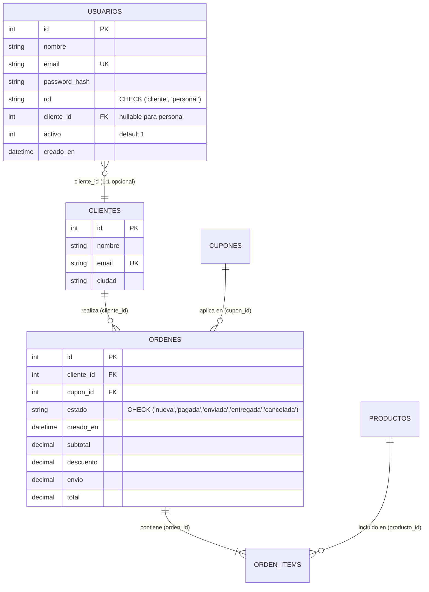

# Laboratorio #2 - Caso 5: Juguetería Online "Mundo Juguete"

> **Materia:** Programación Web & BackEnd  
> **Estudiante:** Daniel Ortiz Rivera  
> **Caso de Estudio:** Caso 5 - Juguetería Online "Mundo Juguete" con control de inventario infantil en transacciones ACID, validación estricta de cupones, cálculo dinámico de tarifas de envío, métricas de agregación SQL, autenticación real con roles (Cliente y Personal) en cookies httpOnly e integración con Agente de IA en n8n.

---

## 📋 Resumen del Proyecto

Este repositorio contiene la solución completa de extremo a extremo para el **Laboratorio 2 (Caso 5)** en la juguetería **"Mundo Juguete"**:

1. **Base de Datos Relacional (`schema.sql`):** Esquema SQLite con llaves foráneas (`PRAGMA foreign_keys = ON`), restricciones de integridad `CHECK`, transacciones ACID, tabla `usuarios` vinculada a `clientes`, e inserción de datos iniciales (*seed data* con cuentas demo hasheadas con bcrypt).
2. **Backend API REST Seguro (`/backend`):** Servidor Node.js con Express organizado por capas (`routes/`, `controllers/`, `services/`, `middlewares/`), validaciones con códigos de estado HTTP apropiados (200, 201, 400, 401, 403, 404, 409), autenticación con JWT en cookie `httpOnly`, transacciones atómicas con `better-sqlite3` y middleware de control de acceso por roles.
3. **Frontend React SPA (`/frontend`):** Aplicación cliente construida con Vite, React 19, React Router, contexto de autenticación persistente (`AuthContext`), protección de rutas (`CustomerRoute`, `StaffRoute`, `PublicRoute`), vistas públicas para clientes (`/`, `/catalogo`, `/productos/:id`, `/carrito`, `/mi-cuenta`), área administrativa para personal (`/admin/...`) y estilo visual *"Nube de algodón"* con detalles de *"Catálogo de cuento"*.
4. **Automatización & Agente IA (`n8n_workflow.json`):** Flujo de trabajo exportado para n8n sin credenciales externas con Webhook entrante, router condicional (*Switch*), generación de descripciones comerciales y motor de recomendaciones personalizadas para el carrito bajo contrato `{ ok, data, error }`.
5. **Colección de Pruebas:** Archivo de Thunder Client (`thunder-collection_laboratorio2.json`), suite de pruebas de esquema (`tests/verify_schema.js`), suite de endpoints (`tests/test_endpoints.js`) y suite completa de autenticación y autorización (`tests/test_auth.js`).

---

## 🔐 Modelo de Autenticación y Seguridad

La aplicación implementa autenticación real de extremo a extremo. **La autorización se valida obligatoriamente en el backend en cada petición mediante middlewares**, garantizando que el frontend solo actúe como una capa de presentación y experiencia de usuario.

### 1. Tabla `usuarios` y Relación con `clientes` y `ordenes`



#### Arquitectura de Relación:
- **Cuentas de Cliente (`rol = 'cliente'`):** Cada cuenta de cliente tiene una relación 1:1 con un registro en la tabla `clientes` mediante la llave foránea `cliente_id`. Esto conserva la estructura de órdenes existente y permite mantener datos comerciales como la ciudad de entrega. Al registrarse un cliente en `POST /api/auth/register`, se inserta atómicamente el registro en `clientes` y en `usuarios`.
- **Cuentas de Personal (`rol = 'personal'`):** El personal de tienda administra el negocio. Su campo `cliente_id` es `NULL` y no puede crear órdenes desde el carrito público ni simular compras como cliente.
- **Aislamiento Estricto de Órdenes:**
  - Cuando un cliente crea una orden (`POST /api/ordenes`), el backend **extrae obligatoriamente el `cliente_id` de su sesión JWT**. Cualquier `cliente_id` enviado maliciosamente en el cuerpo de la petición es ignorado.
  - Cuando un cliente consulta órdenes (`GET /api/ordenes` o `GET /api/ordenes/:id`), el backend solo le devuelve sus propias órdenes. Si intenta acceder a una orden ajena, recibe un código **HTTP 403 (Forbidden)**.
  - El personal de tienda tiene visibilidad completa de todas las órdenes y puede cambiar estados o cancelar cualquier orden.

### 2. Medidas de Seguridad Implementadas

1. **Hasheo de Contraseñas:** Hasheadas unidireccionalmente con `bcryptjs` (salt rounds 10). Las contraseñas nunca se guardan en texto plano ni se devuelven en respuestas JSON.
2. **Tokens JWT en Cookies `httpOnly`:**
   - Token firmado con `JWT_SECRET` y expiración en 24 horas.
   - Almacenado en cookie `httpOnly`, impidiendo accesos mediante JavaScript malicioso (protección contra XSS).
   - Atributos de cookie: `sameSite: 'lax'`, `secure: process.env.NODE_ENV === 'production'`.
3. **Mensajes de Error Genéricos:** Ante intentos de inicio de sesión fallidos, se devuelve el mensaje neutral `"Credenciales inválidas"` con código **HTTP 401**, evitando enumeración de correos.
4. **Middlewares de Backend:**
   - `requireAuth`: Rechaza con **401** si no hay cookie/token válido o si la cuenta está inactiva.
   - `requireRole(...roles)`: Rechaza con **403** si el rol del usuario no tiene los permisos requeridos.

---

## 🔑 Credenciales Demo de Desarrollo

Para facilitar la revisión y pruebas en entornos de desarrollo local, la base de datos incluye cuentas preconfiguradas:

| Rol | Correo Electrónico | Contraseña | Destino en la Aplicación |
|---|---|---|---|
| **Personal de Tienda** | `personal@mundojuguete.cr` | `Password123!` | Panel de Administración (`/admin/dashboard`) |
| **Cliente Demo 1** | `carlos.mora@example.com` | `Password123!` | Cuenta Personal (`/mi-cuenta`), Carrito y Catálogo |
| **Cliente Demo 2** | `lucia.f@example.com` | `Password123!` | Cuenta Personal (`/mi-cuenta`), Carrito y Catálogo |

> En la página de login (`/iniciar-sesion`) se encuentran botones de acceso rápido que rellenan automáticamente las credenciales demo.

---

## 🌐 Matriz de Rutas y Permisos

### 1. Endpoints de la API Backend

| Método | Endpoint | Acceso | Descripción |
|---|---|---|---|
| `POST` | `/api/auth/register` | Público | Registra exclusivamente clientes (`nombre`, `email`, `password`, `ciudad`) |
| `POST` | `/api/auth/login` | Público | Inicia sesión para cualquier rol; emite cookie `httpOnly` |
| `POST` | `/api/auth/logout` | Autenticado | Invalida la sesión y borra la cookie |
| `GET` | `/api/auth/me` | Autenticado | Devuelve los datos de la sesión actual sin hashes sensibles |
| `GET` | `/api/productos` | Público | Catálogo de juguetes activos (búsqueda, filtros y orden) |
| `GET` | `/api/productos/:id` | Público | Detalle de un juguete por ID |
| `GET` | `/api/productos/categorias` | Público | Listado de categorías disponibles |
| `GET` | `/api/clientes/calcular-envio` | Público | Calcula costo de envío según ciudad y subtotal |
| `POST` | `/api/cupones/validar` | Público | Valida si un cupón aplica al carrito en vivo |
| `GET` | `/api/resumen` | **Solo Personal** | Métricas SQL (ingresos, top 3, estados, alertas de stock) |
| `GET` | `/api/productos/admin` | **Solo Personal** | Catálogo completo (activos e inactivos) para gestión |
| `POST` | `/api/productos` | **Solo Personal** | Crea nuevo juguete en el inventario |
| `PUT` | `/api/productos/:id` | **Solo Personal** | Actualiza juguete existente |
| `DELETE` | `/api/productos/:id` | **Solo Personal** | Elimina juguete |
| `GET` | `/api/clientes` | **Solo Personal** | Listado completo de clientes registrados |
| `GET` | `/api/cupones` | **Solo Personal** | Listado de cupones con conteo de usos |
| `POST` | `/api/cupones` | **Solo Personal** | Crea nuevo cupón de descuento |
| `PATCH` | `/api/ordenes/:id/estado` | **Solo Personal** | Avanza estado de cualquier orden |
| `PATCH` | `/api/ordenes/:id/cancelar`| **Solo Personal** | Cancela orden y repone inventario en transacción |
| `GET` | `/api/ordenes` | **Autenticado** | Cliente: solo sus órdenes. Personal: todas las órdenes |
| `GET` | `/api/ordenes/:id` | **Autenticado** | Cliente: solo si es suya (403 si es ajena). Personal: cualquiera |
| `POST` | `/api/ordenes` | **Solo Cliente** | Crea orden; personal rechazado con 403 |

### 2. Rutas del Frontend React

| Ruta | Guardia | Descripción |
|---|---|---|
| `/` | `PublicRoute` | Página de bienvenida e inicio de Mundo Juguete |
| `/catalogo` | `PublicRoute` | Catálogo de juguetes con filtros y buscador |
| `/productos/:id` | `PublicRoute` | Ficha técnica detallada del juguete |
| `/carrito` | `PublicRoute` | Carrito de compras con integración de checkout seguro |
| `/iniciar-sesion` | `PublicRoute` | Formulario dual: "Soy cliente" y "Soy parte del personal" |
| `/registro` | `PublicRoute` | Formulario de registro exclusivo para clientes |
| `/acceso-denegado` | `PublicRoute` | Pantalla informativa ante falta de permisos de rol |
| `/mi-cuenta` | `CustomerRoute` | Perfil del cliente, bienvenida e historial de sus propias órdenes |
| `/admin` | `StaffRoute` | Dashboard gerencial con métricas y gráficos |
| `/admin/productos` | `StaffRoute` | Gestión de inventario y editor de juguetes |
| `/admin/ordenes` | `StaffRoute` | Gestión integral de todas las órdenes de la tienda |
| `/admin/nueva-orden` | `StaffRoute` | Creación manual de órdenes internas |
| `/admin/asistente-ia`| `StaffRoute` | Laboratorio de pruebas del agente IA de n8n |

---

## 🧪 Pruebas Automatizadas del Sistema

El proyecto cuenta con tres suites de pruebas automatizadas:

```bash
# 1. Verificar restricciones del esquema SQL (llaves foráneas, CHECKs, UNIQUEs)
npm run test:schema --prefix backend

# 2. Batería de pruebas de Autenticación y Autorización (23 pruebas)
node backend/tests/test_auth.js

# 3. Batería de endpoints de negocio y transacciones (28 pruebas)
node backend/tests/test_endpoints.js
```

### Cobertura de las Pruebas de Autenticación (`test_auth.js`):
- Registro de cliente exitoso con emisión de cookie `httpOnly`.
- Rechazo de registro por correo duplicado (409) y contraseña corta (400).
- Rechazo de login con credenciales incorrectas (401) con mensaje genérico.
- Inicio de sesión de personal y cliente con emisión de JWT.
- Verificación de sesión activa y no sensible en `/api/auth/me`.
- Cierre de sesión y limpieza de cookies en `/api/auth/logout`.
- Restricciones de rol: 401 sin sesión y 403 con rol incorrecto en `/api/resumen`, `/api/clientes`, etc.
- Bloqueo a personal de tienda para crear compras en el carrito (403).
- Inyección forzada de `cliente_id` por el backend al crear órdenes.
- Aislamiento de órdenes: cliente solo ve sus órdenes en `/api/ordenes`.
- Bloqueo de cliente al consultar orden de otro cliente en `/api/ordenes/:id` (403).
- Permiso concedido a personal para ver cualquier orden y cancelarla.

---

## 🎨 Experiencia Visual "Nube de Algodón"

El diseño visual mantiene coherencia temática con la identidad infantil de Mundo Juguete:
- **Paleta Pastel:** Crema cálido (`#FAF7F2`), blanco puro (`#FFFFFF`), rosa palo (`#DE7B94`), lavanda suave (`#8E74BE`), menta pastel y celeste.
- **Tipografía Amigable:** Encabezados redondeados y legibles combinados con textos limpios.
- **Iconografía Consistente:** Iconos lineales mediante `lucide-react`. **Sin emojis**.
- **Comportamiento del Header:**
  - **Sin sesión:** Muestra botones *"Iniciar sesión"* y *"Crear cuenta"*.
  - **Cliente autenticado:** Muestra *"Mi cuenta"*, acceso al carrito y *"Cerrar sesión"*.
  - **Personal autenticado:** Oculta el menú de compra y muestra acceso directo al *"Panel Interno"* y *"Cerrar sesión"*.

---

## 🚀 Guía de Instalación y Ejecución

### 1. Variables de Entorno
Crea o revisa `backend/.env` (basado en `backend/.env.example`):
```env
PORT=3001
DATABASE_FILE=./data/tienda.db
JWT_SECRET=mundo_juguete_jwt_secret_dev_key_2026
FRONTEND_URL=http://localhost:5173
N8N_WEBHOOK_URL=http://localhost:5678/webhook/tienda-ai
```

### 2. Inicializar Base de Datos y Dependencias
```bash
# Backend
cd backend
npm install
npm run init-db

# Frontend
cd ../frontend
npm install
```

### 3. Ejecutar los Servidores de Desarrollo
```bash
# Terminal 1 - Backend
cd backend
npm run dev

# Terminal 2 - Frontend
cd frontend
npm run dev
```
- La tienda pública abrirá en **`http://localhost:5173`**.
- La API de Express responderá en **`http://localhost:3001`**.